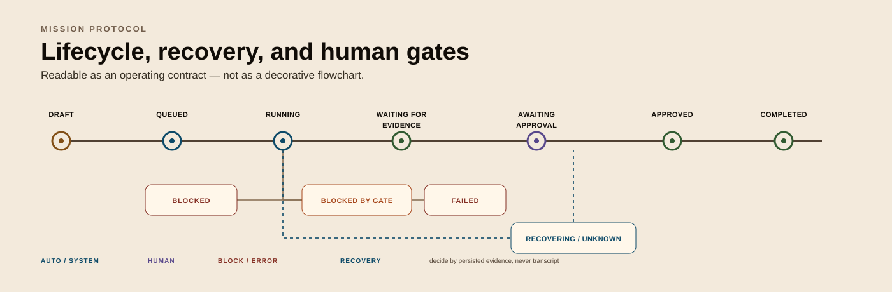
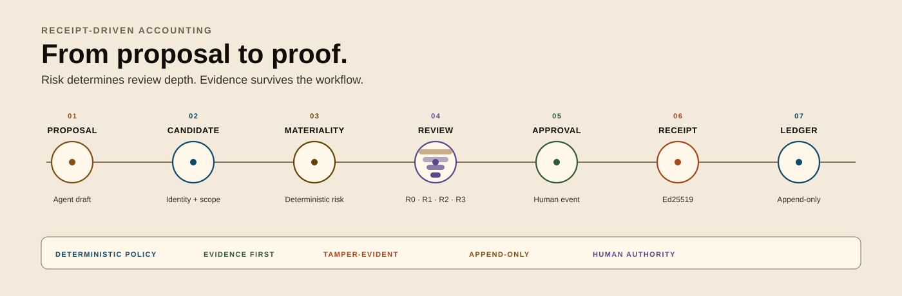
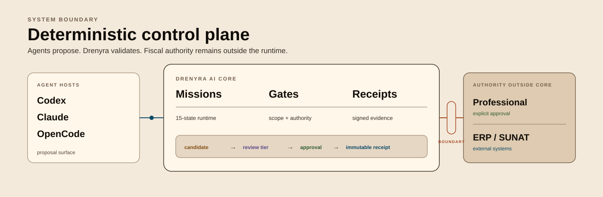

<a id="top"></a>

<div align="center">

<picture>
  <source media="(prefers-color-scheme: dark)" srcset="docs/assets/brand/drenyra-ai-banner.dark.svg">
  
</picture>

<h1>Drenyra AI</h1>

<p><strong>The verifiable accounting runtime for the agents and systems you already use.</strong></p>

<p>
<a href="https://www.npmjs.com/package/drenyra-ai"></a>
<a href="https://github.com/arkelythex/drenyra-ai/actions/workflows/ci.yml"></a>

<a href="LICENSE"></a>
</p>

<p>
<a href="#get-started"><strong>Get started</strong></a> &bull;
<a href="docs/intended-usage.md"><strong>Why Drenyra AI</strong></a> &bull;
<a href="docs/usage.md"><strong>CLI</strong></a> &bull;
<a href="docs/sdk.md"><strong>SDK</strong></a> &bull;
<a href="#documentation"><strong>Documentation</strong></a>
</p>

<p>
An agent can suggest a journal correction or a monthly close. That does not tell
you which bytes were reviewed, who approved them, or what actually happened.
<strong>Drenyra AI gives that work an identity, deterministic controls, and evidence you can verify.</strong>
</p>

<sub>Agents propose · The system validates · The professional decides · Evidence remains</sub>

</div>

> [!IMPORTANT]
> **Current release: [v0.6.0](https://www.npmjs.com/package/drenyra-ai).** The npm `latest` channel is the released artifact; these docs track `main` and may describe unreleased changes. Six core contracts are frozen. See the [CHANGELOG](CHANGELOG.md) and [version policy](RELEASING.md).

<!-- -->

> [!NOTE]
> Publicly visible source is not a permissive license. Source use, copying, and distribution remain governed by the proprietary [LICENSE](LICENSE). The open-core transition is an intention, not a contractual promise.

<div align="center"><picture><source media="(prefers-color-scheme: dark)" srcset="docs/assets/brand/drenyra-mark.dark.svg"></picture></div>

<a id="what-it-does"></a>
<a id="key-features-you-should-know-about"></a>

## Features

### Receipt-Driven Accounting — replace a claim with proof


An agent saying “done” is not an audit trail. Every material action requires an
immutable receipt, bound to its subject and verifiable through a hash, an Ed25519
signature, and trusted signer material. The append-only audit ledger preserves
order and exposes divergence. **It proves execution; it is not the accounting
journal of record.**

**[Docs →](docs/architecture/receipt-ledger-model.md)** · **[Receipt contract →](contracts/receipt.md)**

---

### Candidates and review — spend attention where risk lives


Reviewing everything at the same depth wastes professional attention; trusting
an agent's confidence is worse. A candidate gives each proposal content-derived
identity and materiality. Policy derives R0–R3 from **BigInt cents, reversibility,
and jurisdiction**. Unknown jurisdictions escalate, changed bytes need
re-inspection, and a candidate gets at most one scoped correction.

**[Docs →](contracts/candidate.md)** · **[Authority and approval →](docs/architecture/authority-model.md)**

---

### Missions and recovery — a restart is not a new truth


A lost process must not turn an interrupted operation into an assumed success.
Missions have a frozen 15-state lifecycle, idempotency replay, and explicit
recovery semantics. **Persisted events, not a transcript, determine what can
resume.** Evidence and approval waits stay paused until their own conditions
are resolved. The CLI recovery sweep marks in-flight `RUNNING` missions
`UNKNOWN`; evidence reconciliation is a separate step.

**[Docs →](contracts/recovery.md)** · **[Operational recovery →](docs/runbooks/04-recovery.md)**

---

### Gates and tenant scope — context is not permission


A convincing proposal is not approval, and a remembered decision is not current
authority. Gates validate the transition, receipt, and required approval inside
the exact RUC/company/period scope. Missing authority fails closed. Agents stage
work; they never perform fiscal approval or claim SUNAT, bank, or ERP execution.
**Memory informs; it never authorizes.**

**[Docs →](docs/architecture/trust-model.md)** · **[Gate contract →](contracts/gate.md)**

---

<a id="core-workflow"></a>

### Fiscal discipline — keep the order, not just the output


A close is not a pile of independent calculations. The fiscal lifecycle follows
**capture → classification → reconciliation → close → declaration → audit**.
The monthly-close vertical composes deterministic reconciliation and close
calculations with evidence and approval gates. This discipline does not imply
that a configured agent can submit declarations or move money on its own.

**[Docs →](docs/fiscal-authority-kernel-chain.md)** · **[Monthly-close design →](docs/design/design-02-monthly-close.md)**

### Also in the core

| Surface | What it gives you |
| --- | --- |
| **CLI** | Missions, candidate inspection, gates, receipt verification, and ledger validation |
| **Typed SDK** | Released ESM subpaths for runtime, domain engines, and integration |
| **MCP** | The same core over stdio JSON-RPC 2.0, through `drenyra-ai mcp serve` |
| **Configurator** | `install run`, `doctor run`, `sync run`, `upgrade run`, and `rollback run` for existing hosts |
| **Skills** | Versioned, jurisdiction-scoped knowledge; a skill is not approval or evidence |
| **Guardian** | Read-only adversarial findings over candidates; never fiscal authority |

<div align="right"><a href="#top">Back to top</a></div>

<div align="center"><picture><source media="(prefers-color-scheme: dark)" srcset="docs/assets/brand/drenyra-mark.dark.svg"></picture></div>

<a id="quick-start"></a>

## Quick Start

> [!TIP]
> For a five-minute start with prerequisites and install options, see the [Quickstart](docs/quickstart.md); for the full CLI reference, see [Usage](docs/usage.md).

### Install

```bash
npm install drenyra-ai
```

The package ships a prebuilt ESM artifact (`dist/`, Node >= 22), a `drenyra-ai` binary, and library subpaths for each subsystem. Library modules use `node:crypto` only; the CLI adds `ajv` for schema validation.

For a machine-wide binary (global install), use `npm install -g drenyra-ai` — the `drenyra-ai` command then works from any directory.

### Configure the ecosystem (optional)

Once installed, run these to register the accounting/fiscal agent runtime:

| Command | What it does | When to re-run |
| --- | --- | --- |
| `drenyra-ai install run` | Detects agent hosts, writes markers and managed skills assets | First time in a new environment, or after changing hosts |
| `drenyra-ai sync run` | Refresh managed assets, preserving foreign changes | After upgrading the package |
| `drenyra-ai doctor run` | Read-only health check of the ecosystem | Any time something looks wrong |

These are **not required** for the core CLI — missions, receipts, and the ledger work standalone. They configure the ecosystem surface (skills, host markers, memory wiring).

### The CLI

```bash
drenyra-ai --help
```

| Command | What it does |
| --- | --- |
| `drenyra-ai receipt verify <receipt.json> [--keys <keys.json>]` | Verify a signed receipt bundle (hash + Ed25519 signature + trusted signer) |
| `drenyra-ai ledger validate <ledger.json>` | Validate an append-only audit ledger hash chain |
| `drenyra-ai mission start <create-command.json> [--store <file>]` | Create a new mission (DRAFT) |
| `drenyra-ai mission apply <command.json> [--store <file>]` | Apply an execute/approve/reject/reconcile command (real intent handlers by default) |
| `drenyra-ai mission status <missionId> [--store <file>]` | Show a mission snapshot and its event log |
| `drenyra-ai mission recover [--store <file>]` | Crash-safe recovery: mark in-flight RUNNING missions UNKNOWN (idempotent) |
| `drenyra-ai candidate inspect <candidate.json>` | Derive candidate identity + materiality from an inspect file |
| `drenyra-ai candidate verify <candidate.json> --subject <subject-file>` | Revalidate candidate identity against the exact subject bytes |
| `drenyra-ai gate check <gate-input.json>` | Run the standard gates (mission, receipt, approval) over a gate input |
| `drenyra-ai capabilities show` | Declare available contracts, skills, jurisdictions, and adapters |
| `drenyra-ai mcp serve` | Serve the JSON-RPC 2.0 MCP surface over stdio |

Exit codes: `0` success, `1` business error (JSON error to stdout), `2` usage/IO. JSON goes to stdout; the human-readable one-line summary goes to stderr.

#### Audit log

The CLI emits a structured audit log (JSONL — one JSON object per line) for operational events: `mission.started`, `mission.applied`, `mission.apply_failed`, `mission.status_read`, `mission.status_not_found`. Every event always carries the tenant-boundary fields `mission_id`, `ruc`, `period`, `user_id` (fail-closed to `unknown` when the context has no value), plus `level`, `event`, `message`, `timestamp` and optional `details`. The stream is filterable with `jq`, e.g. `jq 'select(.ruc == "20123456789" and .period == "202507")'`.

| Variable | Default | Effect |
| --- | --- | --- |
| `DRENYRA_AUDIT_LOG` | unset | When set to a path, audit lines append to that file; otherwise they go to stderr (stdout stays reserved for command JSON results) |
| `DRENYRA_AUDIT_LEVEL` | `info` | Severity filter — one of `debug`, `info`, `warn`, `error`; events below the level are dropped |

### A minimal session

```bash
# 1. Start a monthly-close mission
drenyra-ai mission start mission-create.json

# 2. Apply an execute command — the intent handler stages work and pauses at the gate
drenyra-ai mission apply mission-command.json

# 3. Show where it stands
drenyra-ai mission status <missionId>

# 4. Verify any receipt and validate the ledger
drenyra-ai receipt verify receipt.json
drenyra-ai ledger validate ledger.json
```

### The target experience

After installation, a professional accountant should be able to say:

> "I use Codex, Claude, or OpenCode — but Drenyra gives them accounting memory, skills, missions, materiality controls, approvals, and verifiable evidence."

```bash
drenyra-ai install run       # configure the accounting/fiscal agent runtime
drenyra-ai doctor run        # read-only health check of the ecosystem
drenyra-ai mission start monthly-close
drenyra-ai candidate inspect correction.json
drenyra-ai gate check posting.json
drenyra-ai receipt verify receipt.json
drenyra-ai ledger validate ledger.json
```

---

## Core Workflow

1. **Install.** Add the package, then use the CLI (or the Drenyra Shell harness) as the runtime.
2. **Start a mission.** A mission is a protocol-driven work unit — `monthly-close`, `correction`, `reconciliation`, `invoice-review`, `compliance-check` — with a frozen lifecycle of 15 canonical states.
3. **Agents stage work; the core decides.** Deterministic `IntentHandler`s stage work and request evidence. Agents never claim SUNAT, bank, or ERP execution and never perform fiscal approval.
4. **Review the candidate.** Review depth is derived from materiality — R0/R1 run autonomously, R2 needs single human approval, R3 needs two distinct approvers. One correction budget, then it is what it is.
5. **Gate the transition.** `mission-state`, `receipt`, and `approval` gates validate authority, scope, and receipts before anything moves.
6. **Receipt everything.** Every material action lands in the append-only ledger. Validate it anytime: `drenyra-ai ledger validate`.

### The mission lifecycle at a glance



Recovery is explicit: in-flight `RUNNING` missions become `UNKNOWN` and resume by **deciding from persisted evidence**, replaying the event log from the last event — never from a transcript. Human-wait states (`WAITING_FOR_EVIDENCE`, `BLOCKED_BY_GATE`, approval) are never auto-recovered.

### Receipt-Driven Accounting at a glance



---

## Architecture Maps

Two generated maps orient you in the runtime before the prose does. They are [Archify](https://github.com/tt-a1i/archify) artifacts built from this repository's own modules and contracts; the `.json` specification next to each artifact is the reviewable source, and the [Documentation Standard](docs/documentation-standard.md#5-diagrams) holds the diagram convention.

### The runtime and contract surface


*Open the [interactive version](https://arkelythex.github.io/drenyra-ai/drenyra-ai-runtime.architecture.html) for pan, zoom, guided views, and relationship tracing.*

- **The path is fixed.** A command enters through thin adapters (`cmd/`, `mcp/`, or the library), `agents/` stages a plan, and `missions/` — the durable runtime — decides what happens next.
- **Authority is derived, never asserted.** Agents propose candidates; materiality R0–R3 sets the review depth; `gates/` validates authority, scope and receipts and fails closed, returning a `needs_input` envelope instead of guessing; a professional approves explicitly at R2 (single) and R3 (dual distinct approvers).
- **Nothing material happens without a receipt.** Every material action produces an immutable, Ed25519-signed receipt, and the append-only ledger chains those receipts so order and integrity survive any single tampering attempt.
- **Recovery reads evidence, not transcripts.** `recovery/` resumes from the last persisted event, and `contracts/` is the normative, versioned public surface every module implements.

### The candidate lifecycle


*Open the [interactive version](https://arkelythex.github.io/drenyra-ai/drenyra-ai-candidate.lifecycle.html).*

- **Identity is bytes.** `subject_hash` is computed over the exact reviewed bytes, so a mutated subject is rejected as `SUBJECT_MUTATED`, and different bytes are a different candidate.
- **One bounded correction.** A correction yields a new subject hash that must pass inspection again; a second correction is `CORRECTION_BUDGET_EXCEEDED`, and later observations become follow-ups instead.
- **Review depth follows materiality.** The tier R0–R3 derives from BigInt cents, reversibility and jurisdiction — never from an agent claim — and an unknown jurisdiction escalates one tier, fail-closed.

---

## Contracts — the frozen public surface

Contracts are the **public surface** of Drenyra AI: transport-agnostic, versioned, and consumed by Drenyra, Drenyra Shell, ERPs, other SaaS, and agent hosts. Each frozen contract is pinned by a conformance suite that runs in CI and fails on drift.

| Contract | Version | Status | Consumed by |
| --- | --- | --- | --- |
| [mission-protocol](contracts/mission-protocol.md) | 0.1 | FROZEN | Drenyra, Drenyra Shell, CLI |
| [candidate](contracts/candidate.md) | 0.1 | FROZEN | Drenyra, Drenyra Shell, review tooling |
| [receipt](contracts/receipt.md) | 0.1 | FROZEN | All consumers, ERPs, auditors |
| [gate](contracts/gate.md) | 0.1 | FROZEN | Drenyra, Drenyra Shell, CI/CD |
| [ledger](contracts/ledger.md) | 0.1 | FROZEN | Auditors, ERPs, Drenyra Shell |
| [recovery](contracts/recovery.md) | 0.1 | FROZEN | Drenyra Shell, CLI |
| [brand-system](contracts/brand-system.md) | 0.3 | DRAFT | Drenyra, Drenyra Shell, Drenyra Engram, Guardian Angel, docs |

**Contract requirements:** versioned · verifiable (canonical vectors + conformance suite) · scope-safe (RUC/company/period where fiscal context applies) · transport-agnostic (no HTTP/CLI/framework bindings) · backward-compatible by default (breaking changes require a major bump and a migration path).

---

## Key Features You Should Know About

### Receipt-Driven Accounting (RDA)

Every material action produces an immutable receipt: content-derived hash, Ed25519 signature, and a trusted-signer verification chain. Receipt verification returns a canonical result shape with a precedence-ordered status chain, and tamper detection is pinned by frozen conformance vectors. Nothing material happens without a receipt — this is the RED (Receipt-Driven Execution) primitive of the ecosystem.

### Audit ledger

An append-only, verifiable ledger: commits are atomic accounting changes, and the hash chain is validated by `ledger validate` with a first-divergence report. Missing signer material **fails closed** — an undefined signature yields a violation, never a `TypeError`.

### Missions and the runtime

The `MissionRuntime` is a durable state machine with idempotency replay, optimistic concurrency, and recovery. Fifteen canonical states, a full `VALID_TRANSITIONS` table, a 30-code error taxonomy, 12 event types, and 5 intents (`monthly-close`, `correction`, `reconciliation`, `invoice-review`, `compliance-check`) — all pinned by the `mission-protocol` conformance suite.

### Candidates and proportional review

Agent proposals are first-class artifacts with content-derived identity (mutated subject → rejection), scope, and materiality. Review depth is derived from materiality — never chosen ad hoc — with a full policy matrix (BigInt thresholds, jurisdiction escalation, R3 ceiling) and a **one-correction budget** per candidate.

### Gates, not faith

Lifecycle transitions validate authority, scope, and receipts before any mutation. The `GateRunner` is fail-closed and returns `needs_input` envelopes: approval tiers (R2 single / R3 dual distinct approvers), receipt fail-closed on signer trust, and mission-state legality with a terminal guard. The **AuthorizationGate** wires a standalone RBAC engine into the approval pipeline — per-approver `close:approve` at exact tenant scope.

### Crash-safe recovery

Per-state recovery policy: `RUNNING`/`RETRYING` recover; `UNKNOWN` is decided by evidence; human-wait states are never auto-recovered by the default policy; terminal states are untouched. Recovery replays the event log from the last persisted event and is idempotent.

### Deterministic fiscal engines

The monthly close runs on deterministic engines — `bank-reconciliation/` (canonical normalization, reference-first matching, fail-closed adjustment drafts) and `close-calculations/` (fixed-asset depreciation, provisions, provisional ISR, closing entries to PCGE 59) — wired into the close vertical with skills (`pe.conciliacion-bancaria`, `pe.isr-mensual`, `pe.cierre-resultados`, …). Fiscal convention throughout: **money is BigInt cents, never floats**.

### Tenant isolation

RUC/company/period scope is enforced in every query and mutation — never access data across RUCs without explicit context. `tenant-core` and `tenant-isolation` are shipped as library subpaths.

---

## Hybrid orchestration vs. Drenyra Core

Drenyra AI orchestrates specialized accounting/fiscal agents through `agents/`: deterministic `IntentHandler` implementations for every mission intent stage work, request evidence, and pause at the evidence or approval gate. The deterministic Core — `missions/` (lifecycle, idempotency, rules), `gates/`, and `receipts/` — enforces policy and recorded approvals for what may actually change; human professionals retain fiscal and business decision authority.

> **Agents never claim SUNAT, bank, or ERP execution and never perform fiscal approval. They only propose and stage work.**



### Layout

```text
cmd/                CLI dispatcher and command adapters
contracts/          Canonical contracts (protocol, candidate, receipt, gate, ledger, recovery)
agents/             Agent orchestration: deterministic intent handlers + registry (stages work only)
missions/           Mission protocol + MissionRuntime (lifecycle, idempotency, events)
candidates/         Candidate identity and materiality
review/             Proportional review lenses and workload forecasting
receipts/           Receipt schemas and verification
ledger/             Audit ledger core
gates/              Lifecycle gates
recovery/           Crash recovery and resumption
tenant-core/        RUC/company/period scope primitives
tenant-isolation/   Tenant isolation enforcement
docs/               Architecture, trust-model, and dependency documentation
```

---

## Consumers

| Consumer | How it uses Drenyra AI |
| --- | --- |
| Drenyra | Fiscal workflows, reviews, approvals |
| Drenyra Shell | Pinned package-local runtime (never `PATH`) |
| CLI | Direct `drenyra-ai` commands |
| External ERPs | Receipt verification, ledger validation |
| Other SaaS | Candidates and gates via contracts |
| Agent hosts | Codex, Claude Code, OpenCode integrations |

## Ecosystem

| Project | Role | Status |
| --- | --- | --- |
| [Drenyra Desktop](https://github.com/arkelythex/drenyra-desktop) | Desktop — web application (consumes) | In development (public) |
| [Drenyra Shell](https://github.com/arkelythex/drenyra-shell) | Pi-native harness (consumes, pinned) | Pre-alpha (public) |
| [Drenyra Engram](https://github.com/arkelythex/drenyra-engram) | Institutional accounting memory (used — informs, never authorizes) | In development (public, Apache-2.0) |
| [Drenyra Skills](https://github.com/arkelythex/drenyra-skills) | Versioned accounting, tax, and operational knowledge | In development (public) |
| [Drenyra Guardian Angel](https://github.com/arkelythex/drenyra-guardian-angel) | Independent, adversarial, continuous verification | In development (public) |

**Direction rule:** Drenyra AI may integrate Drenyra Engram and is consumed by Drenyra and Drenyra Shell. It never depends on Drenyra or Drenyra Shell, and Drenyra Shell never leaks into Drenyra AI's contracts. External systems — ERP, SUNAT, banks — connect through adapters and evidence, never through privileged access.

### Drenyra Dominion Program

Drenyra AI is the **deterministic enforcement core** of the [Drenyra Dominion Program](program/drenyra-dominion/README.md), the federated program master that fixes vision, authority, contracts, dependencies, gates, and sequencing across every Drenyra repository. A single master SDD is complemented by implementable vertical SDDs: each vertical delivers a complete capability that may traverse the repositories it needs (for example, the monthly close spans this repo, Drenyra Shell, and Drenyra Desktop) while every repository keeps its ownership and boundaries.

| SDD | Role in this repository |
| --- | --- |
| [SDD-000](program/drenyra-dominion/sdds/sdd-000-dominion/README.md) | North Star, frontiers, authority, taxonomy, and domain criteria |
| [SDD-010](program/drenyra-dominion/sdds/sdd-010-contracts/README.md) | Ecosystem contracts and release train — multi-repo compatibility and coordinated releases |
| [SDD-030](program/drenyra-dominion/sdds/sdd-030-routing/README.md) | Organic accounting work routing from evidence and risk |
| [SDD-040](program/drenyra-dominion/sdds/sdd-040-rda-v2/README.md) | Receipt-Driven Accounting v2 — frozen candidates, proportional review, bounded correction |
| [SDD-090](program/drenyra-dominion/sdds/sdd-090-guardian/README.md) | Independent, adversarial, strictly read-only verification |

This repository holds only its local change plus a reference to the master program — full specs are never copied here, because they would diverge. The [program README](program/drenyra-dominion/README.md) is the source of truth.

---

## Documentation

| Your task | Start here |
| --- | --- |
| Get running in five minutes | [Quickstart](docs/quickstart.md) |
| Full CLI reference and mission store | [Usage](docs/usage.md) |
| Understand the intended usage and the frozen frontier | [Intended Usage](docs/intended-usage.md) |
| Integrate via the public library surface | [SDK](docs/sdk.md) |
| Navigate the codebase as a maintainer | [Codebase Guide](docs/CODEBASE-GUIDE.md) |
| Understand how fiscal correctness is proven | [Deterministic Testing](docs/testing-deterministic.md) |
| Understand open-core governance and contribution rules | [Governance](docs/governance.md), [CONTRIBUTING](CONTRIBUTING.md), [AI Policy](AI_POLICY.md) |
| Read the frozen design series (frontier, monthly close, agents/skills, persistence, v1.0) | [Design 01](docs/design/design-01-ecosystem-frontier-and-authority.md) → [Design 05](docs/design/design-05-testing-releases-v1.md) |
| Understand the trust model | [Trust Model](docs/architecture/trust-model.md) |
| See the system and its boundaries | [System Context](docs/architecture/system-context.md), [Trust Boundaries](docs/architecture/trust-boundaries.md) |
| Understand receipts vs. ledger entries | [Receipt vs. Ledger Entry](docs/architecture/receipt-ledger-model.md) |
| Understand authority and approval | [Authority Model](docs/architecture/authority-model.md) |
| Understand dependency direction | [Dependency Direction](docs/architecture/dependency-direction.md), [Dependency Rules](docs/architecture/dependency-rules.md) |
| Integrate the ecosystem | [Ecosystem Integration](docs/architecture/ecosystem-integration.md), [Ecosystem Boundaries](docs/architecture/ecosystem-boundaries.md) |
| Storage and persistence | [Storage Model](docs/architecture/storage-model.md) |
| Change or extend a contract | [Contracts](contracts/README.md) — change policy, conformance suites, migration path |
| Track the plan | [ROADMAP](ROADMAP.md) and [CHANGELOG](CHANGELOG.md) |
| Read the ecosystem program (master SDD, waves, gates, program-lock) | [Drenyra Dominion Program](program/drenyra-dominion/README.md) — program source of truth |
| Contribute | [CONTRIBUTING](CONTRIBUTING.md), [AI Policy](AI_POLICY.md), [CODE_OF_CONDUCT](CODE_OF_CONDUCT.md), [SECURITY](SECURITY.md), [CONTRIBUTORS](CONTRIBUTORS.md) |

---

## Next Steps

- **New to the ecosystem?** Read the [Trust Model](docs/architecture/trust-model.md) first — it explains what the runtime can prove and what it cannot.
- **Just installed?** Run the [Quickstart](docs/quickstart.md), then read the [Intended Usage](docs/intended-usage.md) for the mental model.
- **Integrating an ERP or SaaS?** Start with the [Contracts](contracts/README.md) — they are the public, frozen surface.
- **Building on the runtime?** Read the [Architecture](docs/architecture.md) and the [Layer Model](docs/architecture.md#layer-model), and the [Codebase Guide](docs/CODEBASE-GUIDE.md) for where changes belong.
- **Maintaining Drenyra AI?** Use the [Codebase Guide](docs/CODEBASE-GUIDE.md) to find ownership, and [Deterministic Testing](docs/testing-deterministic.md) to verify a change.
- **Contributing?** Read [CONTRIBUTING](CONTRIBUTING.md) and the [AI Policy](AI_POLICY.md), then pick up an item from the [ROADMAP](ROADMAP.md).

---

<div align="center">
<a href="LICENSE"></a>
</div>

Proprietary. © 2026 Arkelythex. All rights reserved. See [LICENSE](LICENSE).
