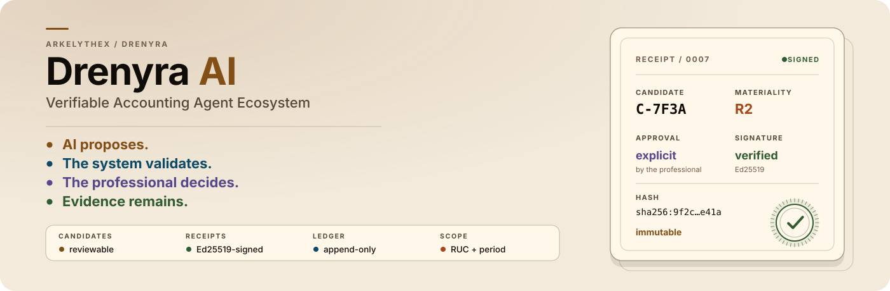

<a id="top"></a>

<div align="center">

<picture>
  <source media="(prefers-color-scheme: dark)" srcset="docs/assets/brand/drenyra-ai-banner.dark.svg">
  
</picture>

<h1>Drenyra AI</h1>

<p><strong>The verifiable accounting runtime for the agents and systems you already use.</strong></p>

<p>
<a href="https://www.npmjs.com/package/drenyra-ai"></a>
<a href="https://github.com/arkelythex/drenyra-ai/actions/workflows/ci.yml"></a>

<a href="LICENSE"></a>
</p>

<p>
<a href="#get-started"><strong>Get started</strong></a> &bull;
<a href="docs/intended-usage.md"><strong>Why Drenyra AI</strong></a> &bull;
<a href="docs/usage.md"><strong>CLI</strong></a> &bull;
<a href="docs/sdk.md"><strong>SDK</strong></a> &bull;
<a href="#documentation"><strong>Documentation</strong></a>
</p>

<p>
An agent can suggest a journal correction or a monthly close. That does not tell
you which bytes were reviewed, who approved them, or what actually happened.
<strong>Drenyra AI gives that work an identity, deterministic controls, and evidence you can verify.</strong>
</p>

<sub>Agents propose · The system validates · The professional decides · Evidence remains</sub>

</div>

> [!IMPORTANT]
> **Current release: [v0.6.0](https://www.npmjs.com/package/drenyra-ai).** The npm `latest` channel is the released artifact; these docs track `main` and may describe unreleased changes. Six core contracts are frozen. See the [CHANGELOG](CHANGELOG.md) and [version policy](RELEASING.md).

<!-- -->

> [!NOTE]
> Publicly visible source is not a permissive license. Source use, copying, and distribution remain governed by the proprietary [LICENSE](LICENSE). The open-core transition is an intention, not a contractual promise.

<div align="center"><picture><source media="(prefers-color-scheme: dark)" srcset="docs/assets/brand/drenyra-mark.dark.svg"></picture></div>

<a id="what-it-does"></a>
<a id="key-features-you-should-know-about"></a>

## Features

### Receipt-Driven Accounting — replace a claim with proof


An agent saying “done” is not an audit trail. Every material action requires an
immutable receipt, bound to its subject and verifiable through a hash, an Ed25519
signature, and trusted signer material. The append-only audit ledger preserves
order and exposes divergence. **It proves execution; it is not the accounting
journal of record.**

**[Docs →](docs/architecture/receipt-ledger-model.md)** · **[Receipt contract →](contracts/receipt.md)**

---

### Candidates and review — spend attention where risk lives


Reviewing everything at the same depth wastes professional attention; trusting
an agent's confidence is worse. A candidate gives each proposal content-derived
identity and materiality. Policy derives R0–R3 from **BigInt cents, reversibility,
and jurisdiction**. Unknown jurisdictions escalate, changed bytes need
re-inspection, and a candidate gets at most one scoped correction.

**[Docs →](contracts/candidate.md)** · **[Authority and approval →](docs/architecture/authority-model.md)**

---

### Missions and recovery — a restart is not a new truth


A lost process must not turn an interrupted operation into an assumed success.
Missions have a frozen 15-state lifecycle, idempotency replay, and explicit
recovery semantics. **Persisted events, not a transcript, determine what can
resume.** Evidence and approval waits stay paused until their own conditions
are resolved. The CLI recovery sweep marks in-flight `RUNNING` missions
`UNKNOWN`; evidence reconciliation is a separate step.

**[Docs →](contracts/recovery.md)** · **[Operational recovery →](docs/runbooks/04-recovery.md)**

---

### Gates and tenant scope — context is not permission


A convincing proposal is not approval, and a remembered decision is not current
authority. Gates validate the transition, receipt, and required approval inside
the exact RUC/company/period scope. Missing authority fails closed. Agents stage
work; they never perform fiscal approval or claim SUNAT, bank, or ERP execution.
**Memory informs; it never authorizes.**

**[Docs →](docs/architecture/trust-model.md)** · **[Gate contract →](contracts/gate.md)**

---

<a id="core-workflow"></a>

### Fiscal discipline — keep the order, not just the output


A close is not a pile of independent calculations. The fiscal lifecycle follows
**capture → classification → reconciliation → close → declaration → audit**.
The monthly-close vertical composes deterministic reconciliation and close
calculations with evidence and approval gates. This discipline does not imply
that a configured agent can submit declarations or move money on its own.

**[Docs →](docs/design/design-01-ecosystem-frontier-and-authority.md)** · **[Monthly-close design →](docs/design/design-02-monthly-close.md)**

### Also in the core

| Surface | What it gives you |
| --- | --- |
| **CLI** | Missions, candidate inspection, gates, receipt verification, and ledger validation |
| **Typed SDK** | Released ESM subpaths for runtime, domain engines, and integration |
| **MCP** | The same core over stdio JSON-RPC 2.0, through `drenyra-ai mcp serve` |
| **Configurator** | `install run`, `doctor run`, `sync run`, `upgrade run`, and `rollback run` for existing hosts |
| **Skills** | Versioned, jurisdiction-scoped knowledge; a skill is not approval or evidence |
| **Guardian** | Read-only adversarial findings over candidates; never fiscal authority |

<div align="right"><a href="#top">Back to top</a></div>

<div align="center"><picture><source media="(prefers-color-scheme: dark)" srcset="docs/assets/brand/drenyra-mark.dark.svg"></picture></div>

<a id="quick-start"></a>

## Get started

Requires **Node.js 22+**. For a binary available from any directory:

```bash
npm install -g drenyra-ai
drenyra-ai --help
drenyra-ai capabilities show
```

For a library dependency, use `npm install drenyra-ai` and follow the
[SDK](docs/sdk.md). A local package install does not add a global shell command;
use `npm exec -- drenyra-ai --help` from that project instead.

Configure existing agent hosts only if you need the ecosystem integration:

```bash
drenyra-ai install run
drenyra-ai doctor run
```

This configures managed assets; it does not install an agent host. The core CLI
and verification functions work without this setup. Read the
[Quickstart](docs/quickstart.md) before starting a mission: commands consume
validated JSON input files, not a bare intent name such as `monthly-close`.

| Task | Command |
| --- | --- |
| Verify a prepared receipt bundle | `drenyra-ai receipt verify receipt.json --keys keys.json` |
| Validate a prepared audit ledger | `drenyra-ai ledger validate ledger.json` |
| Create a mission from a command file | `drenyra-ai mission start mission-create.json` |
| Inspect a persisted mission | `drenyra-ai mission status <missionId>` |
| Read its next-action projection | `drenyra-ai project <missionId>` |

These filenames stand for your validated inputs, not files created by installing
the package. JSON results go to stdout; diagnostics go to stderr. Exit codes are
`0` success, `1` business error, and `2` usage/IO error.

**[Every CLI command, flag, output channel, and audit setting →](docs/usage.md)**

<div align="right"><a href="#top">Back to top</a></div>

<a id="the-frontier"></a>
<a id="hybrid-orchestration-vs-drenyra-core"></a>

## The boundary

Drenyra AI is a **headless core**: protocols, missions, candidates, gates,
receipts, and an audit ledger. It is not the ERP, the professional interface,
the accounting journal of record, or the fiscal authority. External ERPs, SaaS,
and agent hosts can consume it without depending on Drenyra Desktop or Shell.

<details>
<summary><strong>Architecture maps and frozen contracts</strong></summary>

<a id="architecture-maps"></a>

### The runtime and contract surface


[Interactive runtime map](https://arkelythex.github.io/drenyra-ai/drenyra-ai-runtime.architecture.html)
— its viewer retains the Archify palette; inline SVGs use Dreamcoder.

### The candidate lifecycle


[Interactive candidate map](https://arkelythex.github.io/drenyra-ai/drenyra-ai-candidate.lifecycle.html)

<a id="contracts--the-frozen-public-surface"></a>

| Contract | Version | Status |
| --- | --- | --- |
| [Mission protocol](contracts/mission-protocol.md) | 0.1 | FROZEN |
| [Candidate](contracts/candidate.md) | 0.1 | FROZEN |
| [Receipt](contracts/receipt.md) | 0.1 | FROZEN |
| [Gate](contracts/gate.md) | 0.1 | FROZEN |
| [Ledger](contracts/ledger.md) | 0.1 | FROZEN |
| [Recovery](contracts/recovery.md) | 0.1 | FROZEN |
| [Brand system](contracts/brand-system.md) | 0.4 | DRAFT |

Conformance vectors pin the frozen surface. Breaking changes require explicit
approval, a major contract version bump, and a migration path. See the
[contract index](contracts/README.md) for the full roster and change regime.

</details>

## Ecosystem

<a id="consumers"></a>

| Project | Responsibility |
| --- | --- |
| **Drenyra AI** | Deterministic enforcement core; usable standalone |
| [Drenyra Desktop](https://github.com/arkelythex/drenyra-desktop) | Professional interface consuming the core |
| [Drenyra Shell](https://github.com/arkelythex/drenyra-shell) | Pi-native harness consuming a pinned runtime |
| [Drenyra Engram](https://github.com/arkelythex/drenyra-engram) | Institutional memory; informs, never authorizes |
| [Drenyra Skills](https://github.com/arkelythex/drenyra-skills) | Versioned accounting, tax, and operational knowledge |
| [Drenyra Guardian Angel](https://github.com/arkelythex/drenyra-guardian-angel) | Independent adversarial verification |

These are responsibility boundaries, not a claim that every planned integration
is production-ready. Consumers adopt released artifacts; the core does not
import Desktop or Shell.

### Drenyra Dominion Program

The [program master](program/drenyra-dominion/README.md) records the ecosystem's
charter, authority, dependencies, sequencing, and gates. Program-level SDDs are
requirements of record; **ODD is this repository's delivery workflow**. Read the
master rather than copying its requirements into participant repositories.

<div align="right"><a href="#top">Back to top</a></div>

<div align="center"><picture><source media="(prefers-color-scheme: dark)" srcset="docs/assets/brand/drenyra-mark.dark.svg"></picture></div>

## Documentation

| Your next question | Start here |
| --- | --- |
| What is this, and what does it deliberately not do? | [Intended Usage](docs/intended-usage.md) |
| How do I install and run it? | [Quickstart](docs/quickstart.md) · [CLI reference](docs/usage.md) |
| How do I integrate the typed library? | [SDK](docs/sdk.md) · [Contracts](contracts/README.md) |
| Where do trust and authority stop? | [Trust Model](docs/architecture/trust-model.md) · [Authority Model](docs/architecture/authority-model.md) |
| How do the subsystems fit together? | [Architecture](docs/architecture.md) · [Codebase Guide](docs/CODEBASE-GUIDE.md) |
| How is fiscal correctness tested? | [Deterministic Testing](docs/testing-deterministic.md) |
| How do I operate or recover it? | [Runbooks](docs/runbooks/README.md) |
| Which designs and requirements govern the work? | [Design series](docs/design/design-01-ecosystem-frontier-and-authority.md) · [Specs](specs/README.md) · [Program](program/drenyra-dominion/README.md) |
| What changed, and what is planned? | [CHANGELOG](CHANGELOG.md) · [ROADMAP](ROADMAP.md) |
| How should documentation and visuals be authored? | [Documentation standard](docs/documentation-standard.md) |

## Contribute

Read [CONTRIBUTING](CONTRIBUTING.md) before writing code. ODD keeps understood work
small, makes substantial work recoverable, and keeps tests and documentation
with the behavior they explain. Fiscal invariants and frozen contracts are not
style preferences.

[Agent Guide](AGENTS.md) · [AI Policy](AI_POLICY.md) · [Governance](docs/governance.md) ·
[Security](SECURITY.md) · [Code of Conduct](CODE_OF_CONDUCT.md) · [Contributors](CONTRIBUTORS.md)

<a id="next-steps"></a>

**New here?** Start with the [Quickstart](docs/quickstart.md). **Integrating?** Read
the [Trust Model](docs/architecture/trust-model.md), then the [SDK](docs/sdk.md).

<div align="right"><a href="#top">Back to top</a></div>

---

<div align="center">
<picture><source media="(prefers-color-scheme: dark)" srcset="docs/assets/brand/drenyra-mark.dark.svg"></picture>
<p><strong>Verifying beats trusting a narrative.</strong></p>
<p>Proprietary. © 2026 Arkelythex. All rights reserved. <a href="LICENSE">License terms</a>.</p>
</div>
